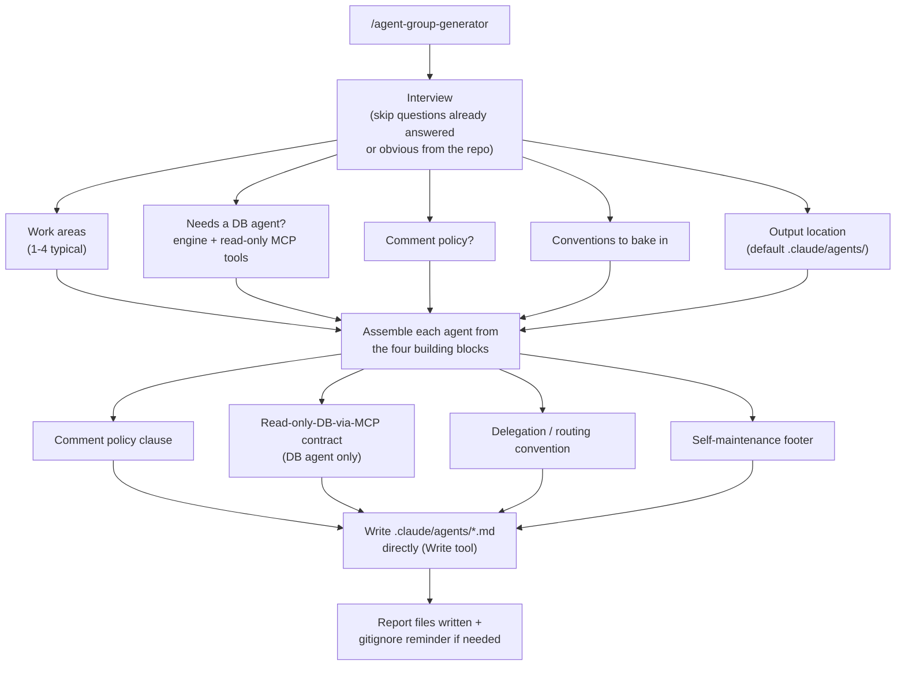
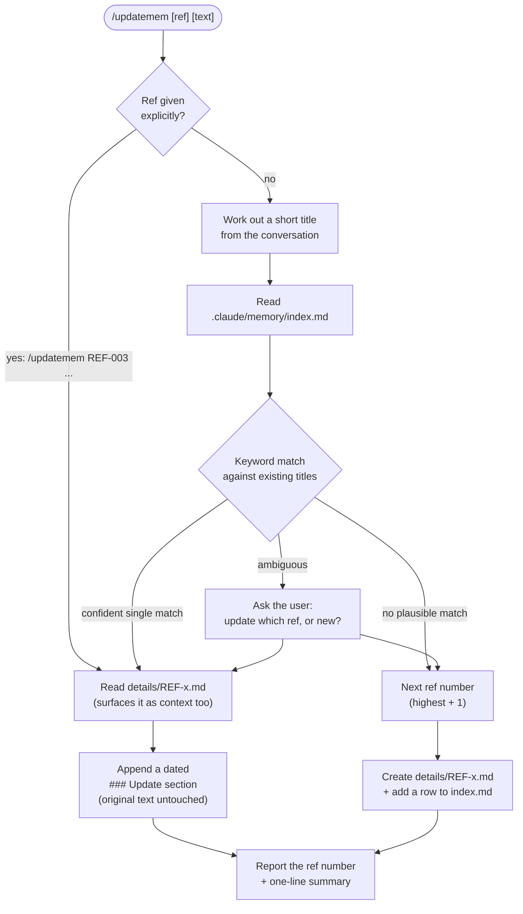
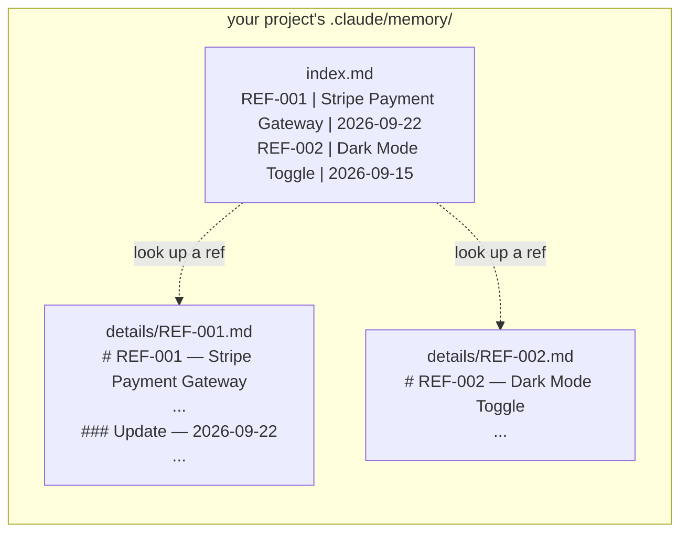
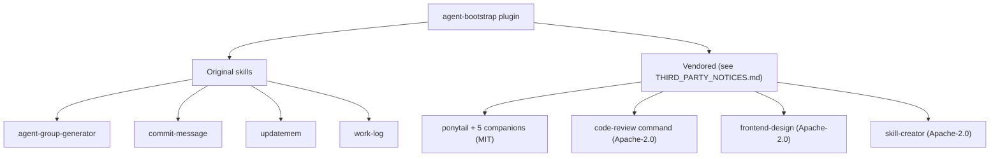

# agent-bootstrap

A Claude Code plugin that bootstraps a tailored subagent group for any project, keeps a token-efficient implementation log, writes your commit messages, and bundles a handful of other generally useful skills — so you don't have to rebuild this setup by hand in every repo.

[](LICENSE) [](THIRD_PARTY_NOTICES.md) 

## Contents

- [What's in it](#whats-in-it)
- [How agent-group-generator works](#how-agent-group-generator-works)
- [How updatemem works](#how-updatemem-works)
- [Repo layout](#repo-layout)
- [Install](#install)
- [Usage](#usage)
- [A note on skill-creator](#a-note-on-skill-creator)
- [Maintaining this plugin](#maintaining-this-plugin)
- [License](#license)

## What's in it

| Component | Type | Origin | License |
|---|---|---|---|
| `agent-group-generator` | skill | original | MIT (this repo) |
| `commit-message` | skill | original | MIT (this repo) |
| `updatemem` | skill | original | MIT (this repo) |
| `work-log` | skill | original | MIT (this repo) |
| `ponytail` + 5 companions | skills | vendored from [DietrichGebert/ponytail](https://github.com/DietrichGebert/ponytail) | MIT |
| `code-review` | command | vendored from `claude-plugins-official` | Apache-2.0 |
| `frontend-design` | skill | vendored from `claude-plugins-official` | Apache-2.0 |
| `skill-creator` | skill | vendored from `claude-plugins-official` | Apache-2.0 |

Full attribution and license text for every vendored piece: [THIRD_PARTY_NOTICES.md](THIRD_PARTY_NOTICES.md).

### The four original skills

- **`agent-group-generator`** — interviews you about your project's work areas, then writes a `.claude/agents/*.md` subagent for each one, built from four reusable patterns: an optional "never comment code" rule, a read-only-database-via-MCP contract for a data specialist agent, a delegation convention between sibling agents, and a self-maintenance footer so each agent tells future-you when its facts need re-checking.
- **`commit-message`** — writes a commit message from your currently staged changes (ticket key from the branch if there is one, Title Case subject, bullets per logical change). Never runs `git commit` itself.
- **`updatemem`** — a token-efficient, per-project implementation log under `.claude/memory/`: a small index (reference number + title) plus one file per entry, so recalling or updating a past feature only ever costs reading one small file, not a whole history. Supports `/updatemem REF-003 ...` to jump straight to a known entry, and falls back to fuzzy title matching (with a confirmation step when it's ambiguous) otherwise.
- **`work-log`** — drafts a Jira timesheet for the days you name from your git commits across the repos in `~/code`, sizes each ticket by commit complexity, and copies the start time, entry sizes and comment style of your recent Jira worklogs (Mon–Fri, 08:00–17:00, 8h a day, one lunch hour at a random slot). It logs to Jira only after you approve the exact sheet.

## How agent-group-generator works



Each generated agent is tailored, not templated — the four building blocks are *patterns* the skill knows how to write well, filled in with your interview answers and whatever the skill finds by reading your actual repo.

## How updatemem works



The design goal is that **recalling or updating an old entry never costs more than reading one small file** — `index.md` stays a short table forever, and each `details/REF-x.md` only ever grows for its own feature, never for the whole project's history.



## Repo layout



## Install

```
/plugin marketplace add Thiraj-tech/agent-bootstrap
/plugin install agent-bootstrap
```

## Usage

- **`/agent-group-generator`** (or just ask to "set up subagents for this project") in any repo — answer its short interview and it writes the agent files directly. Example: for a repo with a Rails API and a React frontend, a "yes" to the DB agent question and a couple of MCP tool names is enough to get three tailored agents (`api`, `frontend`, `db`) with the delegation convention already wired between them.
- **`/commit-message`** with changes staged — reads only what's staged, so it never guesses at work you haven't finished.
- **`/updatemem`** after building or fixing something worth remembering, or **`/updatemem REF-003 fixed the retry bug`** to jump straight to a known entry. The log lives under the installing project's `.claude/memory/` — most projects gitignore `.claude/`, so treat this as a local, single-machine log unless you deliberately carve out that path in your `.gitignore`.
- **`/work-log 16 and 17`** (or "log my time for Monday") — shows the sheet with the evidence and assumptions behind it; edit it in chat, then say "approved" to write the worklogs. Needs the Atlassian MCP connected.
- `ponytail`, `ponytail-review`, etc. and `/code-review` work exactly as their upstream docs describe — see the links in [THIRD_PARTY_NOTICES.md](THIRD_PARTY_NOTICES.md).

## A note on `skill-creator`

This session may already have `skill-creator` available from the official Anthropic marketplace. Installing `agent-bootstrap` alongside it gives you two copies under different plugin namespaces (`agent-bootstrap:skill-creator` vs `skill-creator:skill-creator`) — harmless, since Claude Code namespaces skills by plugin, just don't be surprised to see it listed twice.

## Maintaining this plugin

- **Local test loop:** `/plugin marketplace add <local path>` once, then `/plugin marketplace update agent-bootstrap` after each edit, and re-test in a scratch project before pushing.
- **Versioning:** bump `version` in `.claude-plugin/plugin.json` (semver) and tag the matching commit on each release.
- **Refining `agent-group-generator`:** its real test is running it against a different real project each time — note where the interview was unclear or the output needed hand-editing, and fold that back into `skills/agent-group-generator/SKILL.md`.
- **Keeping vendored copies current:** these are copies, not references, so they will drift from upstream. Periodically diff them against the live upstream sources and pull in changes; record the last-synced upstream version in `THIRD_PARTY_NOTICES.md`.

## License

This repo's own content (agent-group-generator, commit-message, updatemem, work-log, and the packaging around them) is MIT — see [LICENSE](LICENSE). Vendored third-party content keeps its own upstream license — see [THIRD_PARTY_NOTICES.md](THIRD_PARTY_NOTICES.md).
